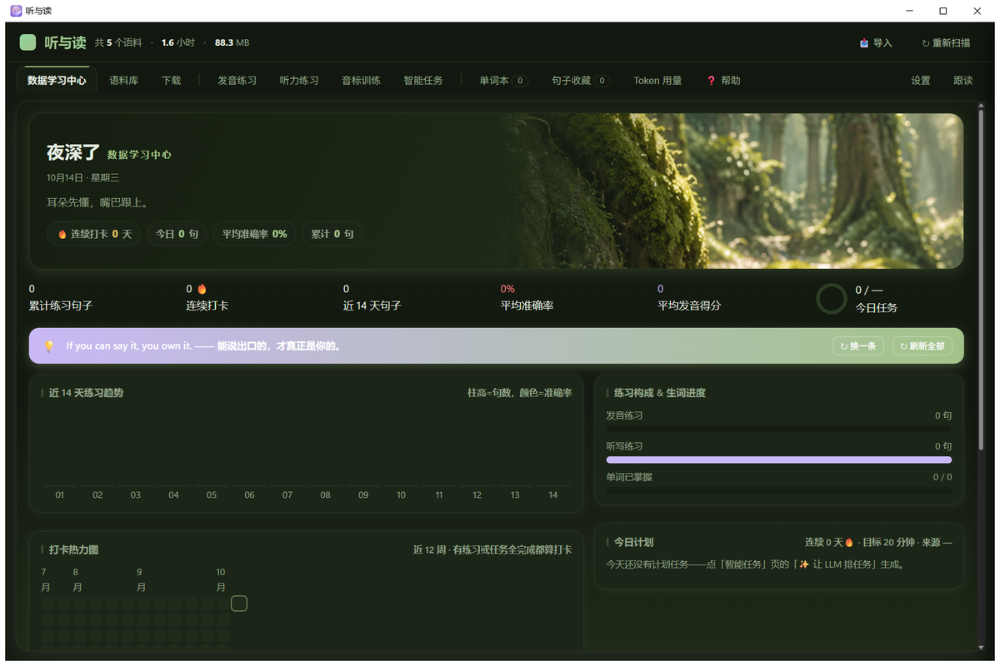
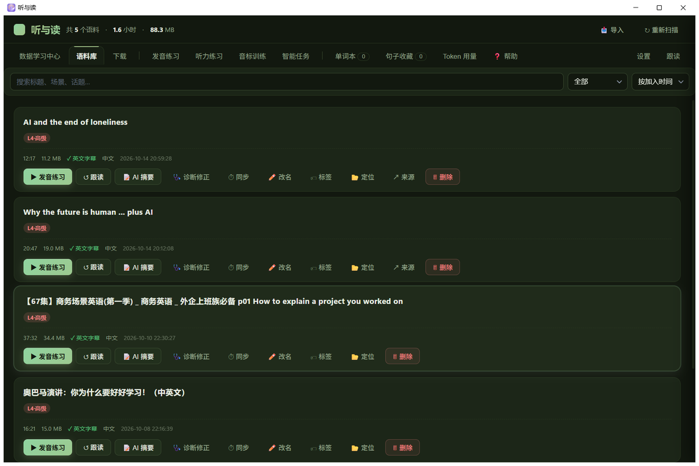
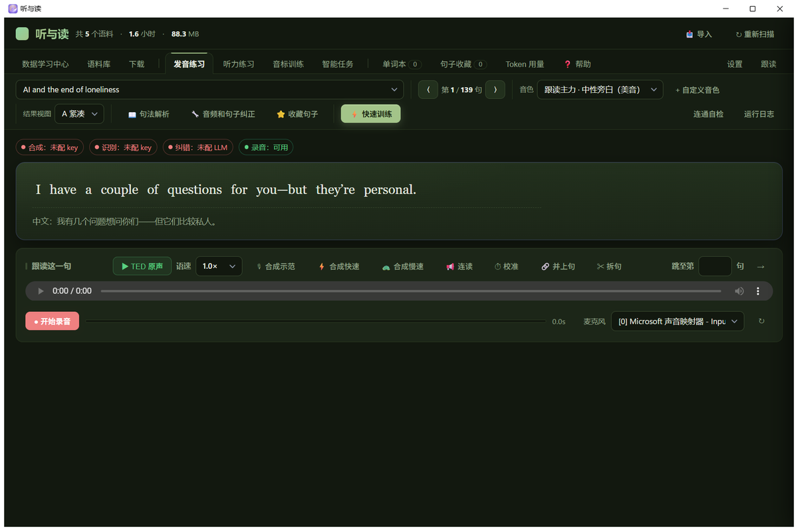
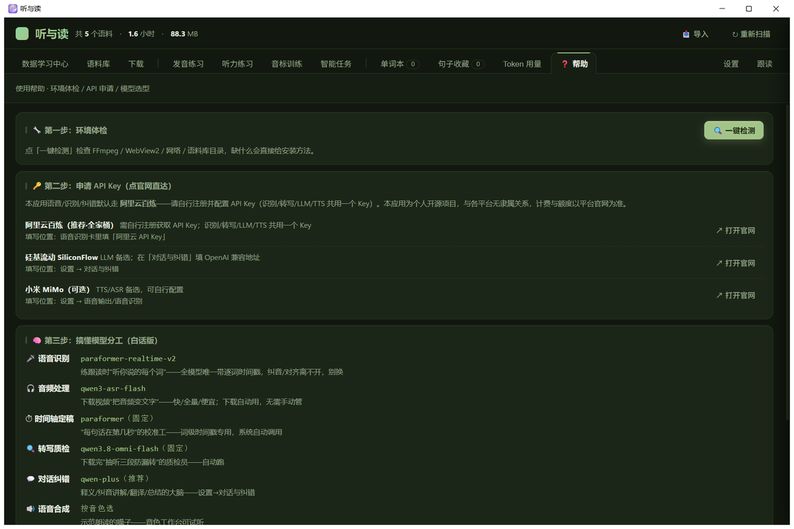

# 听与读 EchoRead · v1.0.0-beta

[](https://opensource.org/licenses/MIT)
[](https://www.microsoft.com/windows)
[](#)

> TED / B站 / YouTube 英语逐句精练工具 —— 听 · 读 · 跟 · 记，每天进步一点点 (๑•̀ㅂ•́)و✧

把喜欢的英文视频变成你的私人英语练习场：**一键下载**音频和中英字幕，**逐句跟读**找出发音漏洞，**听写练习**磨耳朵，**AI 纠音**给你逐词反馈。语料与学习记录全部保存在本地，注册不上传、隐私无压力 (´ω｀)

> 说明：AI 功能需要你自行配置大模型 API Key（可选阿里云百炼、硅基流动、小米 MiMo 等平台）。本应用为个人开源项目，与各平台无隶属关系。

## 📸 界面预览

| 数据学习中心（主界面） | 语料库 |
|:---:|:---:|
|  |  |

| 发音练习 | 使用帮助 |
|:---:|:---:|
|  |  |

## ✨ 核心特性

- 🎬 **智能下载** — 粘贴链接，自动获取音频、中英字幕和对照文稿。字幕三级兜底（视频自带 CC → 语音识别转写 → LLM 翻译），下载完成还会自动质检（抽听三段防漏转）和生成场景摘要，到手即练 ᕕ( ᐛ )ᕗ
- 🎤 **逐句跟读** — 录下你的声音，AI 逐词比对（读错 / 漏读 / 多读一目了然），针对每个错词给出发音提示，点词即可收藏
- 👂 **听力练习** — 全文听写 / 填空 / 首字母三种模式 × 三档难度，本地批改 + AI 错因讲解；还有"脱稿大意"挑战
- 📊 **数据学习中心** — 主界面一站式看板：打卡热力图、14 天趋势、LLM 学习总评，九套主题随心切换 (￣▽￣)
- 🎯 **智能任务** — 让 AI 读你的练习记录和生词，自动安排今天 4-6 项任务，完成打卡，连续天数不中断
- 📚 **生词本 + 记忆卡** — 点词即出音标、释义、例句、记忆法；按遗忘曲线提醒复习；可导出 Markdown
- 🔍 **句法解析** — AI 拆解长难句的语法结构、短语搭配；选中任意片段即可划线分析
- 🛠️ **语料管理** — 难度自动分级、话题快筛、句子合并 / 拆分（词级时间戳）、音画校准、AI 诊断修正

## 🚀 三步上手

### 1️⃣ 安装

**最简单**：下载 `EchoRead-v1.0.0-beta-setup.exe` 双击安装，内置 5 条示例语料，打开即练 (•̀ᴗ•́)و

**开发者**：
```bash
git clone https://github.com/Aislight1/EchoRead.git
cd EchoRead
pip install -r requirements.txt
python app.py
```

### 2️⃣ 配置 API Key

去「设置 → 语音识别」粘贴阿里云百炼的 API Key（识别 / 转写 / LLM / TTS 共用一个 Key）；或按需配置其他平台。应用内的「❓ 帮助」页可以一键体检运行环境（缺 FFmpeg 可一键安装）并直达各平台官网。

### 3️⃣ 开始练习

粘贴一个 TED / B站 / YouTube 链接 → 等待自动处理（下载→转写→翻译→质检）→ 点「▶ 发音练习」开始逐句跟读。就这么多！(´･ω･`)

## 🧠 模型分工一览

| 干什么 | 用的模型 | 配置后自动调用 |
|---|---|---|
| 🎤 练习识别（听你的发音，逐词纠音） | paraformer-realtime-v2（阿里云） | ✅ 配置 Key 后自动调用 |
| 🎧 音频处理（音频转文字） | qwen3-asr-flash（阿里云） | ✅ 配置 Key 后自动调用 |
| ⏱ 时间轴定稿（每句话在第几秒） | paraformer 词级对齐（阿里云） | ✅ 配置 Key 后自动调用 |
| 🔍 转写质检（抽听防漏转） | qwen3.8-omni-flash | ✅ 配置 Key 后自动调用 |
| 💬 对话纠错（释义 / 讲解 / 翻译 / 总结） | 你配置的 LLM（推荐 qwen-plus） | ✅ 配置 Key 后自动调用 |
| 🔊 语音合成（示范朗读） | 音色工作台可选（阿里云 / Edge / MiMo） | ✅ 按需配置后自动调用 |

> 识别与转写走阿里云 DashScope；LLM 可选任意 OpenAI 兼容端点。首次使用建议先跑「❓ 帮助」页的环境体检。这些环节消耗的 API 额度为你自己的账户额度，由应用自动调用。

## 🔑 API 配置

| 平台 | 地址 | 用途 |
|---|---|---|
| 阿里云百炼 | [bailian.console.aliyun.com](https://bailian.console.aliyun.com/?apiKey=1#/api-key) | 识别 / 转写 / LLM / TTS（推荐，一个 Key 通吃） |
| 硅基流动 | [cloud.siliconflow.cn](https://cloud.siliconflow.cn/account/ak) | LLM 备选 |
| 小米 MiMo | [xiaomimimo.com](https://www.xiaomimimo.com/) | TTS / ASR 备选 |

> 在「设置」页粘贴对应 Key 即可启用。各平台计费与配额以官网为准。

## 📁 内置示例语料

安装包内置 5 条已处理好的双语语料（音频 + 中英字幕 + 对照文稿），打开即可练习：

1. AI and the end of loneliness（TED）
2. Why the future is human ... plus AI（TED）
3. 商务场景英语 第 1 集（B站）
4. 奥巴马演讲：你为什么要好好学习
5. TED演讲：你的手机，正在蚕食你

> 版权归原作者所有，仅限个人学习使用，请勿二次分发。

## 🗺️ 更多功能

| 功能 | 说明 |
|---|---|
| 44 音标训练 | 逐个跟读评分，≥85 自动标记掌握 |
| 本地导入 | 音频文件直接入库自动转写；纯文本经 AI 断句 + 语音合成变成新语料 |
| 跟读播放器 | 全篇双语字幕、单句循环、0.6×~1.3× 变速、点句跳转 |
| Token 用量 | 按模型 / 功能统计消耗与费用，支持月预算提醒 |
| 使用帮助 | 环境一键体检（FFmpeg 缺失可一键安装）、API 官网直达、模型白话说明 |

## 🤝 参与贡献

欢迎提 Issue 反馈问题或建议新功能 (◕‿◕) 功能请求请说明使用场景，问题反馈请附带「设置 → 诊断」导出的诊断包。

## 📄 License

MIT License — 自由使用、修改和分发。示例语料版权归原作者，仅限学习使用。

---

*如果这个项目对你有帮助，欢迎点一个 ⭐ Star ~ 谢谢！(๑˃̵ᴗ˂̵)و*